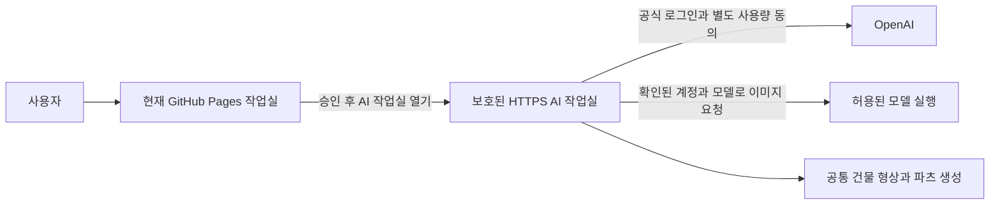

# 기존 URL을 유지하는 ChatGPT 원격 앱 승인 준비

> **이전 기록입니다.** v4는 본인 전용 OSS VM 경로와 원격 서비스 참여 대기 명단을 재구분합니다. 현재 결정·미확인 조건은 [connection-v4.md](connection-v4.md)를 따릅니다. 아래의 “모든 원격 앱에 참여 승인 필요”로 읽힐 수 있는 설명은 현재 적용 판단이 아닙니다.

2026-10-24. 사용자가 선택한 경로는 **기존 링크 유지 — 원격 앱 승인 경로 준비**입니다. 개인 PC 전환과 별도 API 과금은 이번 선택에 포함되지 않습니다.

## 준비한 결과

- 신청 안내: https://tradiative.github.io/dollhouse-pj/connection/
- 영어 소개문: `public/connection/application-draft.en.txt` — 복사·내려받기 가능.
- 현재 데이터 처리 설명: `public/connection/data-handling.html`.
- 현재 상태: 소개문 준비, 제출·승인 미확인, 원격 실행부 미배포, 실제 AI 요청 미실시.

공식 신청 양식 자체를 읽지 못했으므로 소개문을 실제 양식의 필드와 동일하다고 주장하지 않습니다. 이름·연락 이메일·정확한 법인 정보는 사용자가 공식 양식에서 입력합니다. 사업자의 법적 명칭, 신청인 이름·직함·이메일을 추측해 공개 자료에 넣지 않았습니다. 신청을 대신 제출하거나 새 서비스 계정·유료 호스팅을 만들지 않았습니다.

## 실제로 다시 확인한 공식 안내

다음 문서는 HTTP 200으로 읽었습니다.

- [Quickstart](https://developers.openai.com/siwc/quickstart): 웹사이트 SIWC는 현재 일부 상용 파트너 대상 제한 시험이며, plan usage는 별도 적용 조건이 있습니다. Plus/Pro 보유만으로 이 앱의 승인을 확정하지 않습니다.
- [On your website](https://developers.openai.com/siwc/website): 프로비저닝된 OAuth client, 정확히 등록된 HTTPS callback, PKCE/OIDC, 서버의 ID 토큰 검증과 자체 세션이 필요합니다. 이 문서는 identity scopes를 다루며 identity-only 로그인만으로 모델 호출 권한이 생기지 않습니다. 기존 OpenAI 담당자가 있는 경우 대기 명단 문의를 안내합니다.
- [ChatGPT plan usage 개요](https://developers.openai.com/siwc/token-sharing-open-source): 원격/유료 앱에 [공식 관심 등록 양식](https://openai.com/form/sign-in-with-chatgpt-interest/)을 안내합니다. 저장소 공개와 적격 OSS 여부를 같은 것으로 취급하지 않습니다.

양식 링크는 공식 문서에서 확인한 링크입니다. 이 환경에서는 해당 openai.com 호스트에 프록시 403이 발생해 양식의 실제 항목·제출 버튼·응답 시간은 확인하지 못했습니다. 승인 성공이나 접수 번호를 만들어 표시하지 않습니다. 사용자는 자기 브라우저의 공식 양식에서 신청합니다. 심사 기간·승인 여부는 보장하지 않습니다.

## 신청 소개문의 핵심

| 항목 | 준비한 내용 |
| --- | --- |
| 제품 | TRADIATIVE Studio, 건축물 이미지·도면에서 검토 모델·제작 파츠를 만드는 웹 도구 |
| 현재 주소 | `https://tradiative.github.io/dollhouse-pj/` 유지 |
| 초기 사용자 | 제품 운영자 본인의 비공개 베타, Pro 보유 |
| 요청 권한 | 로그인과 별도로, 선택 이미지 해석을 ChatGPT plan usage로 실행할 권한 |
| 현재 검증 | 가변 형상·출력·복원 및 모의 OAuth/모델 요청 검사. 실제 계정 이미지 호출은 미실시 |
| 사용량 | 선택 이미지 최대 6개, 작업당 최대 3회·90초, 사용자별 제한·취소를 원격 실행부에 적용할 계획 |
| 데이터 | 현재 원본은 브라우저 보관. 원격 활성화 전 선택 이미지 전송·보관·해제 절차 검증 |
| 비용 | 별도 API 비활성·자동 전환 없음. 호스팅 서비스·요금 미선택 |
| 비공개 정보 | 신청인·이메일·정확한 법인명은 공식 양식에서 본인이 입력 |

## 승인 후 적용할 구성안

현재 주소를 계속 입구로 사용합니다. AI 로그인과 요청은 HTTPS 원격 작업실에서 같은 출처의 세션으로 처리하는 구성을 제안합니다. 실행부 주소와 callback은 실제 승인·호스팅 조건을 확인한 뒤 정합니다. 현재 사이트에 작동하지 않는 서버 주소나 임의 client ID를 넣지 않았습니다.

GitHub Pages에서 별도 도메인의 인증 쿠키를 무조건 읽을 수 있다고 가정하지 않습니다. 제안한 AI 작업실은 최상위 창에서 로그인과 요청을 처리해 자체 first-party 세션을 사용합니다. 현재 작업실과 자료를 전달하는 기능이 필요하면, 승인된 실제 출처·창·일회성 거래를 검증하고 사용자가 선택한 자료만 전달하도록 추가 검증합니다. OpenAI의 토큰·PKCE verifier·provider authorization code·client secret을 Pages JavaScript로 돌려주는 전달 방식은 사용하지 않습니다.

기존 개인 loopback OAuth 코드는 참고 기반입니다. 동일 기기 제한을 삭제하거나 OSS dynamic registration의 redirect_uri만 바꾸어 원격 앱을 활성화하지 않습니다. 원격 경로는 승인된 등록 방식과 별도 모델 권한 계약에 맞춰 구현해야 합니다.

## 원격 활성화 전에 필요한 구체 항목

이 목록은 준비 계획이며 구현 완료 표시가 아닙니다.

| 항목 | 현재 상태 / 다음 작업 |
| --- | --- |
| 원격 앱 참여 자격과 plan usage | 공식 검토 요청 필요. 승인 문서/응답으로 확인 |
| OAuth 등록·callback·인증 방법 | 미발급·미등록. 제공받은 실제 값만 서버 설정에 등록 |
| 보호된 HTTPS 호스팅 | 미선택·미배포. 무료 범위와 작업 시간/용량을 확인하고 새 비용은 별도 결정 |
| 계정별 서버 세션과 credential 보관 | 원격용 미구현. 안전한 자체 세션·보호된 저장소·만료·해제 적용 |
| 초기 운영자 접근 제한 | 원격용 미구현. 검증한 issuer/client/subject와 운영자 허용 정책을 연결. 공개 방문자에게 소유자 사용량을 제공하지 않음 |
| Origin·CSRF·작업 한도 | 개인 실행용 구현을 단순 해제하지 않고 원격 세션 기준으로 적용·검사 |
| 실제 모델과 지원 기능 | 해당 계정 모델 카탈로그와 이미지·구조화 결과·스트림 계약 확인 |
| 최초 이미지 요청 | 사용자 동의 후 작은 자료로 끝까지 완료하고 형상·파일까지 검사 |

현재 SDK/모델·검색·quota 동작을 미리 확정하지 않습니다. 남은 구독 사용량을 꾸미지 않고, 요청이 거부·중단되면 기존 모델을 보존합니다. 실제 로그인·모델 호출 검증이 완료되기 전에는 M1 또는 자동 AI 모델링 완료로 표시하지 않습니다.

## 사용자에게 필요한 다음 조작 하나

[원격 승인 준비 페이지](https://tradiative.github.io/dollhouse-pj/connection/)의 **공식 신청 페이지 열기**를 누릅니다. 이후 공식 양식의 실제 화면을 기준으로 필요한 항목만 안내합니다.
